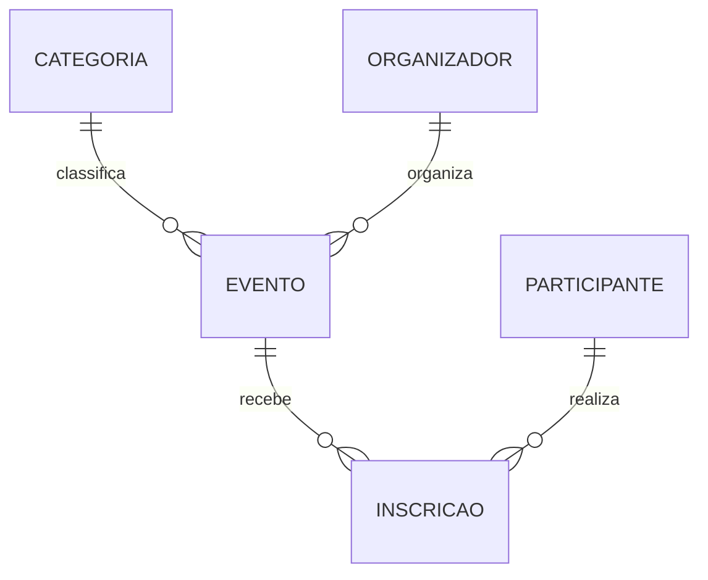

<div align="center">

# Event-Plus

**Banco de dados relacional para gerenciamento de eventos, organizadores, participantes e inscrições.**


</div>

---

## Sobre o Projeto

O **Event-Plus** é um projeto acadêmico da disciplina de Banco de Dados que simula o back-end de um sistema de gerenciamento de eventos.

O banco permite:

- organizar eventos por **categorias**;
- vincular cada evento ao seu **organizador** responsável;
- controlar as **inscrições** dos participantes;
- registrar a **presença** de cada participante nos eventos.

O objetivo foi aplicar, na prática, os conceitos de modelagem relacional, integridade referencial e consultas SQL.

---

## Modelo de Dados

O banco é composto por **5 tabelas**:

| Tabela | Descrição |
|---|---|
| `categoria` | Categorias dos eventos (ex.: tecnologia, música, educação). |
| `organizador` | Organizadores responsáveis pelos eventos e seus contatos. |
| `participante` | Dados cadastrais dos participantes. |
| `evento` | Eventos cadastrados, com data, valor e descrição. |
| `inscricao` | Inscrições dos participantes nos eventos e controle de presença. |

### Diagrama de relacionamentos



### Regras de relacionamento

- Cada **evento** pertence a uma **categoria**.
- Cada **evento** possui um **organizador** responsável.
- Um **participante** pode se inscrever em vários eventos, e um evento pode ter vários participantes (relacionamento **N:N**).
- A tabela `inscricao` resolve esse relacionamento N:N, ligando `participante` e `evento`.

---

## Conceitos Aplicados

| Conceito | Onde aparece |
|---|---|
| Chaves primárias e estrangeiras | Todas as tabelas |
| Constraints e integridade referencial | Relações entre eventos, categorias, organizadores e inscrições |
| `JOIN` | Eventos × categorias, eventos × organizadores, inscrições × participantes |
| Funções de agregação (`COUNT`, `SUM`) | Total de inscrições e arrecadação |
| `GROUP BY` e `HAVING` | Relatórios agrupados e filtrados |
| Subconsultas e filtros | Eventos sem inscrições, participantes recorrentes |

---

## Funcionalidades

- Cadastro de categorias, organizadores e participantes
- Cadastro de eventos com datas, valores e descrições
- Gerenciamento de inscrições
- Controle de presença dos participantes
- Consulta de eventos por categoria
- Identificação de eventos sem inscrições
- Contagem de inscrições por evento
- Cálculo de arrecadação por evento
- Consulta de participantes por cidade
- Identificação de participantes inscritos em múltiplos eventos
- Relatórios de eventos por organizador

---

## Consultas SQL

O projeto inclui consultas que demonstram:

| Objetivo | Recursos utilizados |
|---|---|
| Listar e ordenar eventos | `SELECT`, `ORDER BY` |
| Relacionar eventos com categorias e organizadores | `INNER JOIN` |
| Listar participantes de um evento específico | `JOIN`, `WHERE` |
| Contar inscrições por evento | `COUNT()`, `GROUP BY` |
| Calcular a arrecadação | `SUM()`, operações matemáticas |
| Filtrar eventos com mínimo de inscrições | `HAVING` |
| Encontrar eventos sem participantes | `LEFT JOIN`, `IS NULL` / subconsulta |
| Analisar a distribuição de participantes | Agrupamentos e filtros |

### Exemplo

```sql
-- Arrecadação total por evento
SELECT
    e.nome                          AS evento,
    COUNT(i.id_inscricao)           AS total_inscritos,
    COUNT(i.id_inscricao) * e.valor AS arrecadacao
FROM evento e
LEFT JOIN inscricao i ON i.id_evento = e.id_evento
GROUP BY e.id_evento, e.nome, e.valor
ORDER BY arrecadacao DESC;
```

> Ajuste os nomes das colunas do exemplo acima para os mesmos usados no seu script.

---

## Como Executar

**Pré-requisitos:** [MySQL Server](https://dev.mysql.com/downloads/mysql/) e [MySQL Workbench](https://dev.mysql.com/downloads/workbench/).

```bash
# 1. Clone o repositório
git clone https://github.com/LipinnDEV/event-plus.git
cd event-plus
```

1. Abra o **MySQL Workbench** e conecte-se ao seu servidor local.
2. Abra o arquivo `.sql` do projeto (**File → Open SQL Script**).
3. Execute o script completo (**Execute**) para criar o banco, as tabelas e inserir os dados de exemplo.
4. Rode as consultas da seção de consultas para ver os resultados.

---

## Estrutura do Repositório

```
event-plus/
├── eventplus.sql     # Criação do banco, tabelas, dados e consultas
├── diagrama.png      # Diagrama EER (MySQL Workbench)
└── README.md
```

> Ajuste os nomes dos arquivos conforme o seu repositório.

---

## Objetivo Acadêmico

Desenvolver habilidades em **modelagem de dados, criação de tabelas, inserção de registros, relacionamentos e elaboração de consultas SQL**, aplicando os conceitos de bancos de dados relacionais em um cenário realista.

---

## Autor

**Felipe da Silva Mousinho**
Estudante de Desenvolvimento de Sistemas — SENAI Blumenau

[](https://github.com/LipinnDEV)

---

<div align="center">

**Event-Plus** · Projeto acadêmico de Banco de Dados · Feito para aprendizado e prática de SQL

</div>
